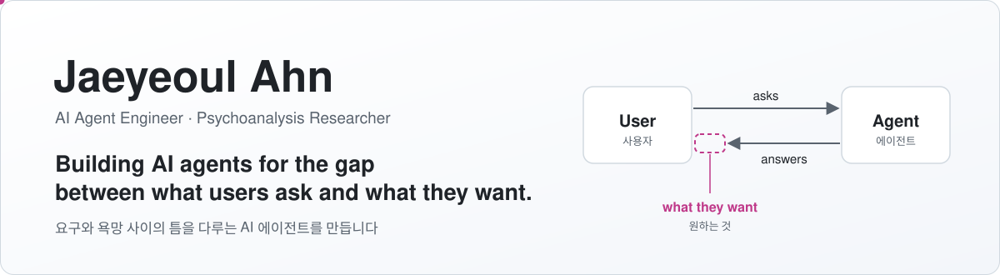

<picture>
  <source media="(prefers-color-scheme: dark)" srcset="assets/banner-dark.svg">
  
</picture>

  
  
  
  

### About

I build AI agents and the backend systems behind them, and I'm preparing to become a psychoanalyst.
These used to look like two separate paths. Now they meet in one place: people bring their questions, their demands and their desires to AI agents.
The agent has become a new **big Other**. I build that Other, and I study the subject who speaks to it.

AI 에이전트와 그 뒤의 백엔드 시스템을 만들고, 정신분석가가 되기를 준비하고 있습니다.
따로 가던 두 길이 지금은 한곳에서 만납니다. 사람들은 이제 질문과 요구, 그리고 욕망을 AI 에이전트에게 건넵니다.
에이전트가 새로운 **대타자**가 된 것입니다. 저는 그 대타자를 만들고, 그 앞에서 말하는 주체를 연구합니다.

<picture>
  <source media="(prefers-color-scheme: dark)" srcset="assets/desire-dark.svg">
  
</picture>

> A prompt is a demand. The agent answers from the place of the Other, the one *supposed to know*. Desire is what no answer covers. 
> 프롬프트는 요구입니다. 에이전트는 '안다고 가정된' 대타자의 자리에서 답합니다. 욕망은 어떤 답으로도 채워지지 않는 그 나머지입니다.

### Concepts, read through AI agents · 에이전트로 다시 읽는 개념

| Psychoanalysis · 정신분석 | AI agents · AI 에이전트 |
|---|---|
| **The big Other** · 대타자 the locus of language and law · 언어와 법이 자리한 곳 | The model as the place every question is addressed to 모든 질문이 건네지는 자리로서의 모델 |
| **Subject supposed to know** · 안다고 가정된 주체 | Why we trust an answer before we check it: transference onto the machine 확인하기도 전에 답을 믿는 이유, 기계를 향한 전이 |
| **Demand and desire** · 요구와 욕망 | The gap between what the prompt asks for and what the user wants 프롬프트가 요구하는 것과 사용자가 원하는 것 사이의 틈 |
| **Desire is the desire of the Other** · 욕망은 타자의 욕망 | Recommendation and personalisation that speak our desire for us 우리 대신 욕망을 말해 주는 추천과 개인화 |
| **Lack** · 결여 | What happens to the subject in front of a machine that never says "I don't know" "모른다"고 말하지 않는 기계 앞에서 주체는 어떻게 되는가 |
| **The unconscious, structured like a language** · 언어처럼 구조화된 무의식 | What language models reveal about the structure of speech 언어 모델이 드러내는 말의 구조 |

### Questions I'm working on · 붙들고 있는 질문

- Whose big Other does an AI agent become? · AI 에이전트는 누구의 대타자가 되는가?
- Can desire be recommended? · 욕망은 추천될 수 있는가?
- What does a user demand of an agent, and what do they desire? · 사용자는 에이전트에게 무엇을 요구하고, 무엇을 욕망하는가?
- In front of a machine that answers everything, where does lack go? · 모든 것에 답하는 기계 앞에서, 결여는 어디로 가는가?

📓 Working notes · 작업 노트: **[the-other-in-the-machine](https://github.com/jb7959/the-other-in-the-machine)**: concept notes, questions and essays · 개념 노트, 질문, 에세이

### Building · 만드는 쪽

Backend engineer: microservices, JVM concurrency and caching, observability, and LLMOps (agent tracing and evaluation). 
백엔드 엔지니어로서 MSA, JVM 동시성과 캐시, 관측 가능성, LLMOps(에이전트 추적·평가)를 다룹니다.

  

  
  
  
  

### Writing · 글

- [AI 에이전트 UX 설계: 쇼핑 에이전트 기획](https://www.companoid.institute/achievement-project/ai-shopping-companion) · *Designing UX for an AI shopping agent: an agent placed in front of desire*
- [고성능 JSON 직렬화를 위한 Fastjson2와 Vector API](https://medium.com/monday-9-pm/초보개발자의-고성능-json-직렬화를-위한-fastjson2와-vector-api-94c06dc777bf) · *Fastjson2 and the Vector API for fast JSON serialization*
- [데이터 지향 설계(Data-Oriented Design) 알아보기](https://medium.com/monday-9-pm/초보개발자-데이터지향-설계-data-oriented-design-알아보기-c0bbd36ea9da) · *An introduction to data-oriented design*
- [Stream Backpressure의 이해](https://doublem.org/stream-backpressure-basic/) · *Understanding stream backpressure*

 

<i>« Le désir de l'homme est le désir de l'Autre. »</i> · Jacques Lacan

