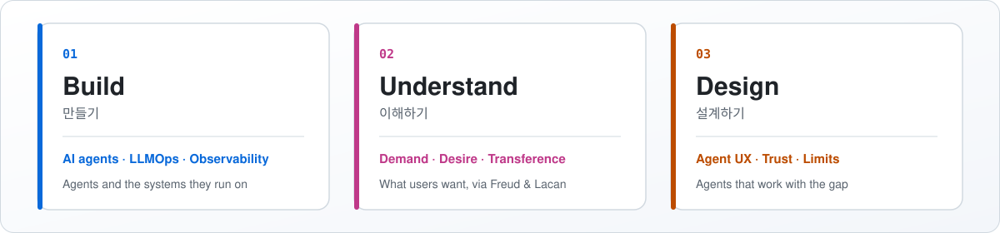

<picture>
  <source media="(prefers-color-scheme: dark)" srcset="assets/banner-dark.svg">
  
</picture>

  
  
  
  

<picture>
  <source media="(prefers-color-scheme: dark)" srcset="assets/pillars-dark.svg">
  
</picture>

<a href="#english">English</a> · <a href="#한국어">한국어</a>

## English

**I build AI agents, and I study what people want from them.**

People ask an agent for an answer, but what they want is rarely just the answer.
I work on that gap from two sides: as an engineer who builds agents and the systems they run on, and as a researcher preparing to become a psychoanalyst.

#### What I bring

- **Build.** AI agents and the backend behind them: LLMOps (tracing and evaluation with Langfuse), observability, and high-traffic systems on the JVM.
- **Understand.** How people relate to agents, read through Freud and Lacan: the gap between demand and desire, trust that works like transference, and what happens in front of a machine that never admits a lack.
- **Design.** Agent experiences that take both into account, such as a conversational shopping agent.

#### Selected work

- **[AI shopping agent UX](https://www.companoid.institute/achievement-project/ai-shopping-companion)**: designing a conversational agent that stands between users and what they want.
- **[The Other in the Machine](https://github.com/jb7959/the-other-in-the-machine)**: working notes on AI agents, desire and lack.
- **Engineering writing**: [Fastjson2 and the Vector API](https://medium.com/monday-9-pm/초보개발자의-고성능-json-직렬화를-위한-fastjson2와-vector-api-94c06dc777bf) · [Data-oriented design](https://medium.com/monday-9-pm/초보개발자-데이터지향-설계-data-oriented-design-알아보기-c0bbd36ea9da) · [Stream backpressure](https://doublem.org/stream-backpressure-basic/)

#### Questions I'm working on

1. Why do users trust a confident answer before they check it?
2. Can a recommendation satisfy desire, or only demand?
3. What should an agent do with "I don't know"?

#### Let's talk

If you build agents and care how people actually use them, or if you work where psychoanalysis meets technology, I'd like to hear from you on [LinkedIn](https://www.linkedin.com/in/jaeyeoul-ahn-a01626108).

## 한국어

**AI 에이전트를 만들고, 사람들이 에이전트에게서 무엇을 원하는지 연구합니다.**

사람들은 에이전트에게 답을 요구하지만, 정작 원하는 것은 대개 그 답만이 아닙니다.
저는 이 틈을 두 방향에서 다룹니다. 엔지니어로서는 에이전트와 그 에이전트가 돌아가는 시스템을 만들고, 정신분석가가 되려고 준비하는 연구자로서는 그 틈이 어디서 생기는지 연구합니다.

#### 하는 일

- **만들기.** AI 에이전트와 에이전트를 뒷받침하는 백엔드를 만듭니다. Langfuse로 에이전트를 추적·평가하는 LLMOps와 관측 가능성, JVM에서 돌아가는 대규모 트래픽 시스템을 다룹니다.
- **이해하기.** 사람들이 에이전트를 대하는 방식을 프로이트와 라캉의 개념으로 읽습니다. 요구와 욕망 사이의 틈, 전이처럼 작동하는 신뢰, 결여를 인정하지 않는 기계 앞에서 일어나는 일을 연구합니다.
- **설계하기.** 이 두 가지를 함께 고려해, 사용자가 에이전트를 쓰는 경험을 설계합니다. 대화형 쇼핑 에이전트가 그 예입니다.

#### 대표 작업

- **[AI 쇼핑 에이전트 UX](https://www.companoid.institute/achievement-project/ai-shopping-companion)**: 사용자와 사용자의 욕망 사이에 서는 대화형 에이전트를 설계했습니다.
- **[The Other in the Machine](https://github.com/jb7959/the-other-in-the-machine)**: AI 에이전트와 욕망, 결여를 다루는 작업 노트입니다.
- **엔지니어링 글**: [고성능 JSON 직렬화를 위한 Fastjson2와 Vector API](https://medium.com/monday-9-pm/초보개발자의-고성능-json-직렬화를-위한-fastjson2와-vector-api-94c06dc777bf) · [데이터 지향 설계 알아보기](https://medium.com/monday-9-pm/초보개발자-데이터지향-설계-data-oriented-design-알아보기-c0bbd36ea9da) · [Stream Backpressure의 이해](https://doublem.org/stream-backpressure-basic/)

#### 연구 질문

1. 사용자는 왜 확신에 찬 답을 확인하기도 전에 믿을까요?
2. 추천은 욕망을 채울 수 있을까요, 아니면 요구만 채울까요?
3. 에이전트는 "모른다"는 말을 어떻게 다뤄야 할까요?

#### 연락

에이전트를 만들면서 사람들이 에이전트를 실제로 어떻게 쓰는지 궁금하신 분, 정신분석과 기술을 함께 다루시는 분이라면 [LinkedIn](https://www.linkedin.com/in/jaeyeoul-ahn-a01626108)으로 연락해 주세요.

---

   
  
  
  

